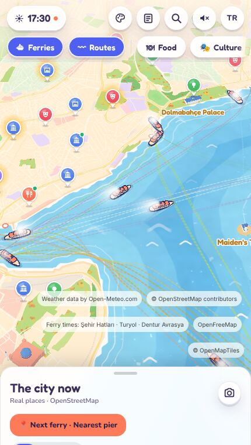
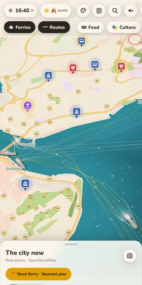
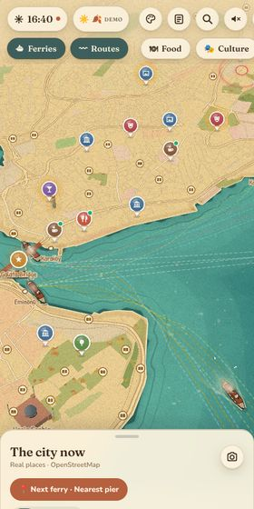
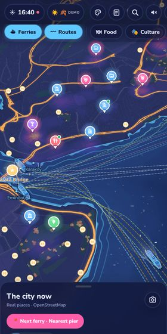

# İstanbul Living City

**A living, mobile-first map of İstanbul: real vapurs crossing the Bosphorus on their printed timetables, a
colourful OpenStreetMap city that follows the real sun and weather, and what's on tonight.**

**Live:** <https://mutallimof.github.io/CityMap/> (best on a phone; installable as an app)

<table>
  <tr>
    <td align="center"><br><b>Toy</b> (default)</td>
    <td align="center"><br><b>Classic</b></td>
    <td align="center"><br><b>Storybook</b></td>
    <td align="center"><br><b>Night</b></td>
  </tr>
</table>

## Features

- **Ferries that move like the real ones.** Seven Şehir Hatları lines on 27 real piers, driven by the
  operator's published timetable (each line is labelled *Official timetable* or *Simulated schedule*). Every
  position is a pure function of clock time; vessels dock side by side, slide along the quay, and never
  cross land. Tap a vapur to follow it, tap a pier for its departure board.
- **A city that lives in real time.** OpenStreetMap vector tiles in our own palettes, 3D buildings with
  lit windows at night, day → golden hour → night from the real sun position, live weather (rain, snow,
  fog, wind) and the seasons.
- **Four switchable looks** — Toy, Classic, Storybook and Night — switched live, without a reload. The
  Toy look adds 3D trees inside real parks and hand-built hero landmarks (Galata Tower, Hagia Sophia,
  the bridges…) at their OpenStreetMap footprints.
- **Places and events.** ~380 featured places with opening hours ("open now"), plus ~340 upcoming events
  from İstanbul cultural venues; filter chips (Today, This weekend, Workshops, Free, categories).
- **Stories.** 500+ historic places with a short Wikipedia summary and a Commons photo.
- **Plan an evening, a day or a trip.** Add places and events to a timeline; the planner connects stops
  only with real options — an approximate walk or the actual ferry from the timetable — and warns about
  closing times and overlaps. Plans stay on the device and can be shared as a read-only link.
- **City sound** (off by default) mixed from real open-licence recordings by time of day, zoom, nearby
  water and weather; ship horns only for real timetabled departures.
- Search, guides, snapshot sharing, Turkish / English, PWA, respects *reduce motion*.

No accounts, no backend, no API keys: static data plus keyless services. Sources and licences:
[docs/data-sources.md](docs/data-sources.md).

## Tech stack

TypeScript (strict) · [Vite](https://vite.dev) · [MapLibre GL JS](https://maplibre.org) ·
[three.js](https://threejs.org) custom layers (water shader, vapurs, scenery) · React for the HUD ·
Vitest. Data pipelines in TypeScript (Turf) and Python; daily / monthly refresh and deployment on
GitHub Actions; hosted on GitHub Pages.

## Run and test

```bash
npm install
npm run dev          # http://localhost:5173
npm test             # unit tests (Vitest)
npm run typecheck
npm run build        # validates routes and timetables, then builds to dist/
```

Useful URL switches for trying things out:

| Switch | Effect |
|---|---|
| `?theme=toy\|classic\|storybook\|night` | pick a look (not saved) |
| `?t=18:30&date=2026-10-12` | jump to an İstanbul time / date; `?speed=60` runs the clock faster |
| `?weather=rain\|snow\|fog\|storm\|wind&season=spring` | weather / season demo |
| `?view=lng,lat,zoom[,pitch,bearing]` | start at a camera position (`?intro=0` skips the intro) |
| `?skyline=1`, `?stress=40` | night skyline test mode, extra vessels for performance tests |
| `#place=…`, `#pier=…`, `#plan=…` | deep links (shared places, pier boards, plans) |

## Project layout

```
src/
  sim/        pure ferry schedule and vessel poses (real timetables, berths, docking)
  ferries/    3D vapurs, wake, smoke, gulls + pier / vessel sheets
  water/      water shader and coast distance field
  map/        map style, OpenFreeMap city layers, building workers
  themes/     the four looks (one file each) and the live theme switch
  places/ events/ stories/ guides/ search/   content and its UI
  plan/       the planner (pure model and timeline, share links, UI)
  audio/      city sound (pure mix + Web Audio engine)
  weather/ time/   live weather, seasons, sun position and palettes
  ui/ app/    React HUD, app controllers (daylight, performance ladder, PWA)
scripts/      data builders, validators, event scrapers, timetable parser
data/         processed data the site ships with (refreshed by GitHub Actions)
```

## How it was built

Designed and directed by its owner and built in conversation with
[Claude Code](https://claude.com/claude-code), Anthropic's coding agent, working in phases: a plan, then
small verified steps — each one tested, screenshotted in a headless browser and deployed. Ground rules
from the start: real data only (no invented coordinates or demo posts), beauty and smooth motion first,
60 fps on a mid-range phone, and every visual constant in one place. The running project memory lives in
[CLAUDE.md](CLAUDE.md).

## Rights

© the project owner. All rights reserved — this repository has no open-source licence. Map data
© OpenStreetMap contributors; other data, sounds and fonts keep their own licences
([docs/data-sources.md](docs/data-sources.md)).
